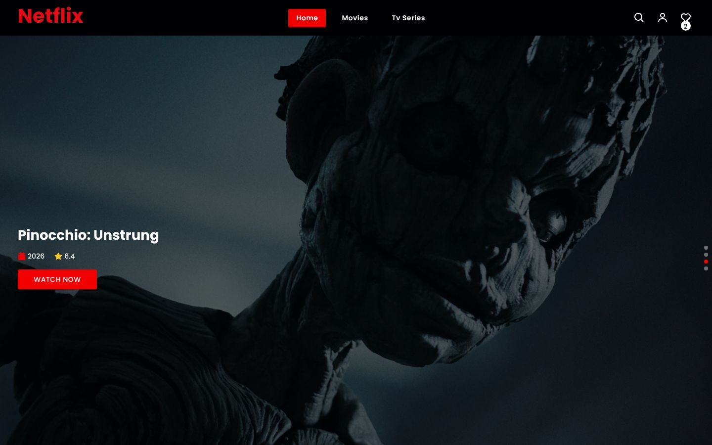
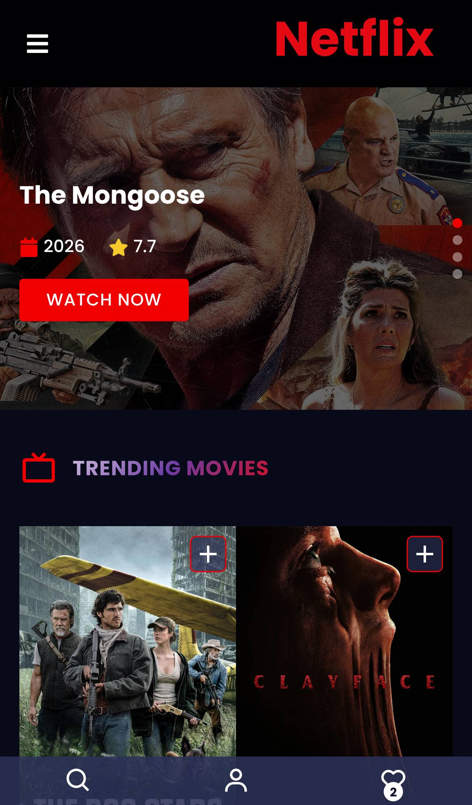

<div align="center">

# Netflix UI Clone

### A movie and TV streaming-style app built with React, Redux Toolkit, Firebase and TMDB

Browse trending and top-rated movies and series, filter by genre, year and sort order, search movies, TV shows and actors, open detailed title pages, sign in and keep a favorites list.

[](https://react.dev)
[](https://redux-toolkit.js.org)
[](https://reactrouter.com)
[](https://firebase.google.com)
[](https://swiperjs.com)
[](https://developer.themoviedb.org)
<br>
[](https://ornate-dusk-5e6e69.netlify.app/)

**[Live demo](https://ornate-dusk-5e6e69.netlify.app/)** ·
**[Portfolio](https://new-portfolio-ashy-xi.vercel.app/)** ·
**[LinkedIn](https://www.linkedin.com/in/eslamraafat-dev/)** ·
**[Email](mailto:eslamraafat736@gmail.com)**

<br>



</div>

<table>
  <tr>
    <td width="33%"></td>
    <td width="67%" valign="top">
      <b>Mobile layout</b><br><br>
      On small screens the top navigation becomes a hamburger menu, and search, account and favorites move to a fixed bottom bar. Each movie card has a <b>+</b> button that adds the title to favorites.
    </td>
  </tr>
  <tr>
    <td align="center"><sub>Mobile (iPhone 13)</sub></td>
    <td></td>
  </tr>
</table>

---

## Contents

- [Overview](#overview)
- [Features](#features)
- [Tech stack](#tech-stack)
- [Routes](#routes)
- [Project structure](#project-structure)
- [Getting started](#getting-started)
- [Deployment](#deployment)
- [Author](#author)

## Overview

A **UI clone built for practice. It is not affiliated with or endorsed by Netflix.** I built it in 2023 as my largest React practice app at the time. It covers route loaders and lazy-loaded pages in React Router 6, global state split between Redux Toolkit slices and Context + `useReducer`, Firebase authentication, and many TMDB endpoints.

## Features

### Browsing

- **Hero slider** (Swiper, autoplay) of trending titles, each with year, rating and a "Watch now" button.
- **Home rows:** trending movies, series airing today, top-rated movies and series, popular movies and series.
- **Movies and TV Series pages** with filters for **genre**, **year** and **sort order** (popularity, release date, vote average, vote count), plus pagination (react-paginate).

### Title details

- **Details page** for any movie or series: a backdrop banner, then tabs for **cast**, **reviews** and **more details**.
- **Videos, backdrops and posters** sections, and a "You may also like" row of similar titles.
- **Person pages** for actors, with their biography and a media section.

### Search

- **Search page** with tabs for **movies**, **TV** and **actors**.

### Accounts and favorites

- **Sign up, log in and log out** with Firebase Authentication (email and password), shown in a modal.
- **Favorites:** add or remove titles from any card. The list is stored in the Firebase Realtime Database and shown on the Favorites page, with a confirm dialog before removal.
- **Toast messages** (react-toastify) confirm actions.

### UX and performance

- **Lazy-loaded pages:** every page except Home is loaded with `React.lazy` and `Suspense`, and gets its data from a route loader.
- **Custom `useHttp` hook,** loading spinners, an error page and a scroll-to-top button.
- **Responsive layout** with a bottom action bar on mobile.

## Tech stack

| Area | Tools |
| --- | --- |
| UI | React 18.2 (Create React App) |
| Routing | React Router 6 (`createHashRouter`, route loaders, lazy routes) |
| State | Redux Toolkit + React Redux (auth, favorites); Context + `useReducer` (movies, series, search) |
| Back end | Firebase Authentication, Firebase Realtime Database |
| Data | TMDB REST API |
| UI libraries | Swiper, react-paginate, react-icons, react-toastify |
| Hosting | Netlify |

## Routes

| Route | Page |
| --- | --- |
| `#/` | Home: hero slider and category rows |
| `#/movies` | Discover movies (genre / year / sort filters) |
| `#/tvSeries` | Discover TV series (same filters) |
| `#/:type/:id` | Movie or series details |
| `#/person/:personId` | Actor page |
| `#/search` | Search with movie / TV / actor tabs |
| `#/favorites` | Saved favorites |

## Project structure

This repository holds the **production build** that is deployed to Netlify. The React source isn't committed here, but the source maps in `static/js/*.map` include it (`pages/`, `components/`, `context/`, `store/`, `router/`, `hooks/`, `api/`, `firebase/`).

```
Netflix/
├── index.html          # CRA entry page
├── static/js           # main bundle + lazy-loaded page chunks, with source maps
├── static/css
├── manifest.json · robots.txt · logos
└── docs/screenshots/
```

## Getting started

The build uses absolute asset paths (`/static/...`), so serve it from the root of a local server:

```bash
git clone https://github.com/Eslamraafat1/Netflix.git
cd Netflix
npx serve .        # routes are hash-based, so no rewrite rule is needed
```

You need an internet connection, because data comes from TMDB and Firebase.

## Deployment

Deployed on **Netlify**: <https://ornate-dusk-5e6e69.netlify.app/>

## Credits

Movie and TV data and images are provided by [TMDB](https://www.themoviedb.org). This product uses the TMDB API but is not endorsed or certified by TMDB. "Netflix" is a trademark of Netflix, Inc., and is used here only to describe what the UI imitates.

---

## Author

**Eslam Raafat**, Front-End Developer (React · Next.js · TypeScript)

**[Portfolio](https://new-portfolio-ashy-xi.vercel.app/)** ·
**[LinkedIn](https://www.linkedin.com/in/eslamraafat-dev/)** ·
**[GitHub](https://github.com/Eslamraafat1)** ·
**[Email](mailto:eslamraafat736@gmail.com)**
